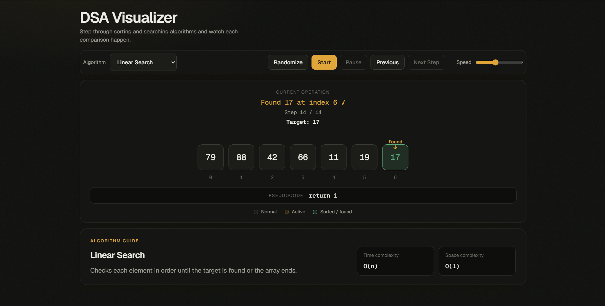
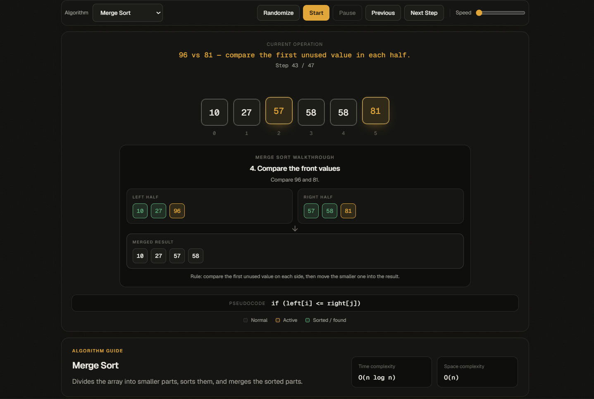

# DSA Visualizer





A small browser app that shows sorting and searching algorithms running one step at a time. Pick an algorithm, hit Next Step, and watch what it compares, swaps and skips. It's plain HTML, CSS and JavaScript, with no frameworks and no build step.

Live demo: https://agam991.github.io/dsa-visualizer/

## What's in it

**Sorting:** Bubble, Selection, Insertion, Merge and Quick Sort

**Searching:** Linear Search and Binary Search

Each run starts with a random array of 5 to 10 numbers. You can:

- go forward and back one step at a time
- let it play on its own, with pause/resume and a speed slider
- see the pseudocode line for the current step
- read a short description and the time/space complexity of the selected algorithm

Merge Sort also gets its own panel showing the left half, the right half and the merged result, because the array alone doesn't make the splitting and merging easy to follow.

## Run it locally

The code uses ES modules, so opening `index.html` by double-clicking won't work. Browsers block module imports from `file://`. Use a local server instead:

1. Open the folder in VS Code.
2. Install the Live Server extension if you don't have it.
3. Right-click `index.html` and choose "Open with Live Server".

## How it's put together

```text
index.html
style.css
Js/
├── main.js                  wires up the buttons and keeps track of state
├── algorithms/
│   ├── sorting.js           each sort returns a list of steps
│   └── searching.js         same idea for the two searches
└── visualization/
    ├── renderer.js          draws one step on the page
    └── animator.js          the autoplay loop
```

The idea is that each algorithm doesn't draw anything. It runs on a copy of the array and records every step (what's being compared, which values are sorted, which line of pseudocode it's on). The renderer then replays those steps. That's what makes the Previous button easy: going back is just showing an earlier step.

## Notes

- Binary Search needs sorted input, so for that one the demo sorts the array before it starts.
- Quick Sort is shown with its average complexity, O(n log n). The worst case is O(n²).
- Merge Sort uses O(n) extra space for arrays.
- The fonts (Geist and Geist Mono) load from Google Fonts. Offline, the page falls back to system fonts.

## Things I'd like to add

- more algorithms (heap sort, BFS/DFS on a small graph)
- let the user type in their own array
- show a running count of comparisons and swaps